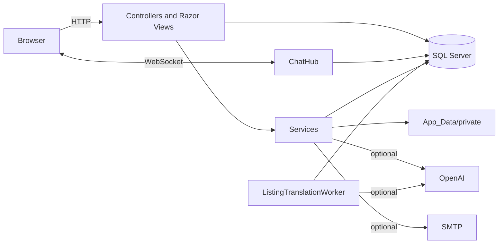
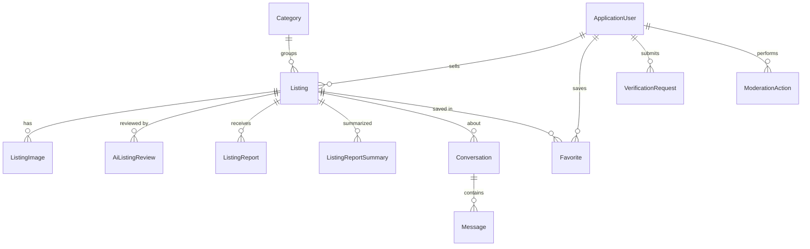
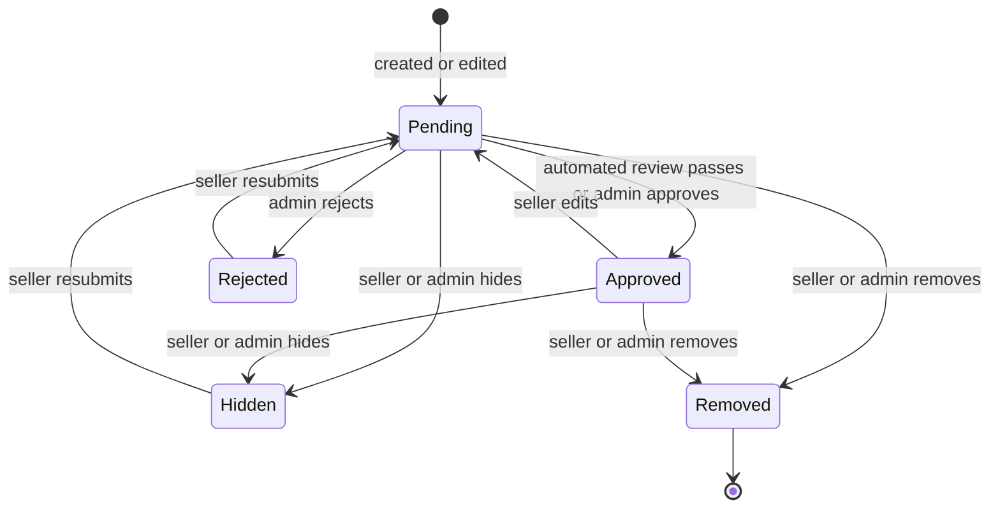
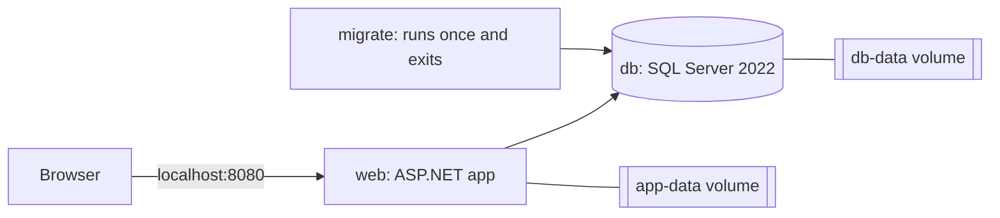

# ZU Market: Technical Documentation

ZU Market is a bilingual (English and Arabic) second-hand marketplace for verified Zarqa University students. Students list items with photos, browse by faculty, and message each other privately. Automated checks and administrators decide what becomes public.

**Contents**

1. [Run it with Docker](#1-run-it-with-docker)
2. [Run it without Docker](#2-run-it-without-docker)
3. [Technology](#3-technology)
4. [Repository layout](#4-repository-layout)
5. [Architecture](#5-architecture)
6. [Data model](#6-data-model)
7. [Main workflows](#7-main-workflows)
8. [Controllers and routes](#8-controllers-and-routes)
9. [Services](#9-services)
10. [Security and privacy](#10-security-and-privacy)
11. [Localization](#11-localization)
12. [Front end and design system](#12-front-end-and-design-system)
13. [Configuration reference](#13-configuration-reference)
14. [Docker design](#14-docker-design)
15. [How to make common changes](#15-how-to-make-common-changes)
16. [Git workflow](#16-git-workflow)
17. [Known limitations](#17-known-limitations)
18. [Before going to production](#18-before-going-to-production)

---

## 1. Run it with Docker

This is the recommended way to run the project. You only need [Docker Desktop](https://www.docker.com/products/docker-desktop/) and Git. You do not need .NET or SQL Server.

```bash
git clone <repository-url>
cd <repository-folder>
docker compose up --build
```

The first start takes a few minutes while images download and the app compiles. When the log shows the `web` service running, open **http://localhost:8080**.

| Task | How |
|---|---|
| Sign in as administrator | `admin@zumarket.local` / `Admin_Dev_2026!` |
| Create a student | Register with any address ending in `@zu.edu.jo`. No real email is sent: the page shows the confirmation link. |
| Make a listing public | Without an OpenAI key, listings wait for approval. Approve them under Administration > Listings. |
| Turn on the AI features | Copy `.env.example` to `.env`, set `OPENAI_API_KEY`, then run `docker compose up -d`. |
| Run in the background | `docker compose up -d --build` |
| Follow the logs | `docker compose logs -f web` |
| Stop, keeping data | `docker compose down` |
| Reset everything | `docker compose down -v` (deletes the database and uploaded photos) |
| Apply newly pulled code | `docker compose up --build` |

Every laptop gets its own empty database containing only the categories. Listings, users and photos are not shared between teammates.

**Troubleshooting**

| Symptom | Fix |
|---|---|
| Port 8080 or 14333 is in use | Set `WEB_PORT` or `DB_PORT` in `.env`. |
| `db` keeps restarting or never becomes healthy | SQL Server needs at least 2 GB of memory. Check Docker Desktop's resource settings. |
| Very slow or crashing on an Apple Silicon Mac | SQL Server has no ARM image. Enable "Use Rosetta for x86/amd64 emulation" in Docker Desktop. |
| Changed `.env` passwords had no effect | They only apply to a new database. Run `docker compose down -v`. |
| `migrate` failed | Read `docker compose logs migrate`. |
| Camera does not work from another device | Browsers only allow the camera on HTTPS or `localhost`. File upload still works. |

## 2. Run it without Docker

You need the .NET 8 SDK and SQL Server (Express is enough). By default the app connects to `localhost\SQLEXPRESS01` using Windows Authentication.

```powershell
dotnet restore
dotnet tool restore
dotnet ef database update
dotnet user-secrets set "InitialAdmin:Email" "your-admin-address"
dotnet user-secrets set "InitialAdmin:Password" "a-strong-unique-password"
dotnet user-secrets set "InitialAdmin:FullName" "Administrator Name"
dotnet run --launch-profile https
```

The app runs at https://localhost:7278. `README.md` covers email, AI and other optional settings.

There is no test project or linter. `dotnet build` plus running the app are the only automated checks.

| Flag (`dotnet run -- <flag>`) | Effect |
|---|---|
| `--migrate-database` | Applies EF migrations and exits. |
| `--check-ai-configuration` | Reports whether OpenAI settings loaded, with no network call. |
| `--check-ai-provider` | Sends a real request to OpenAI. |
| `--inspect-database` | Prints the server, database and migration state. |

The last three are disabled outside Development.

## 3. Technology

| Area | Choice |
|---|---|
| Runtime and web | .NET 8, ASP.NET Core MVC with Razor Views |
| Database | SQL Server through Entity Framework Core 8 |
| Authentication | ASP.NET Core Identity with cookies |
| Real-time chat | SignalR |
| AI (optional) | OpenAI Moderation API and Responses API, called over HTTP |
| Email | SMTP |
| Front end | Bootstrap 5.1, jQuery, plain JavaScript and one CSS file |
| Font | Readex Pro, self-hosted (SIL Open Font License) |
| Packaging | Docker and Docker Compose |

## 4. Repository layout

```text
Controllers/        MVC controllers: Home, Account, Listings, Messages, Verification, Admin
Hubs/               ChatHub, the SignalR hub
Models/             Entities, ApplicationDbContext, view models and enums
Services/           Business logic, AI integration, file storage, email, localization
Views/              Razor views, one folder per controller, plus Shared/
Resources/          SharedResource.resx (English) and SharedResource.ar.resx (Arabic)
Migrations/         EF Core migrations
wwwroot/
  css/site.css      All custom styles
  js/               site.js, listing-draft.js, camera.js, chat.js, signalr-lite.js
  fonts/            Readex Pro and its license
  images/brand/     ZU Market logos
  videos/           Home page campus video and poster
  lib/              Bootstrap, jQuery and validation libraries
assets/             Brand identity board (not served)
Program.cs          Startup: services, command-line flags and the request pipeline
Dockerfile          Builds the web application image
docker-compose.yml  Runs the web app, database and migration together
```

`App_Data/` is created at runtime for uploads and encryption keys. It is ignored by git.

## 5. Architecture

The project is a single deployable MVC application. Design choices worth knowing:

- **No repository layer.** Controllers use `ApplicationDbContext` directly. Logic moves into a service when it is shared, complex, or depends on outside systems.
- **Per-action authorization.** `[Authorize]` only proves that someone is signed in. Selling and messaging also require `ApplicationUser.CanUseMarketplace`, and each action checks that by hand. **New actions must do the same.**
- **AI is advisory and optional.** The site must keep working with no key, and AI output must never publish, approve or remove anything by itself. The one exception is the guarded auto-approval described in [Automated review](#automated-review).
- **The database is the queue.** The translation worker finds its work by querying for approved listings with no translation, so no message broker is needed.
- **Private files stay outside `wwwroot`.** Every file is served by a controller action that checks permissions first.



**Request pipeline** (`Program.cs`, in order): exception handling, HSTS outside Development, request localization, status code pages, HTTPS redirection, static files, routing, authentication, authorization, rate limiting, then the `/chat-hub` endpoint and the default route `{controller=Home}/{action=Index}/{id?}`.

**Background and startup services:** `IdentitySetupService` creates the `User` and `Admin` roles at startup and, in Development only, the first administrator. `ListingTranslationWorker` polls every 20 seconds.

## 6. Data model



| Entity | Purpose | Notes |
|---|---|---|
| `ApplicationUser` | Identity user plus `FullName`, `UniversityId`, `College`, `VerificationStatus`, `IsDisabled` | `CanUseMarketplace` means Approved and not disabled. |
| `Category` | 14 faculties and Other | `Key` is a resource name, `Slug` selects the icon. Seeded by migrations. |
| `Listing` | An item for sale | Holds moderation fields and the cached translation. |
| `ListingImage` | Metadata for a stored photo | Up to 6 per listing, deleted with the listing. |
| `Favorite` | A saved listing | Composite key of user and listing. |
| `Conversation` | Chat between buyer and seller about a listing | Unique per listing, buyer and seller. |
| `Message` | One chat message | Up to 2000 characters, with `ReadAtUtc`. |
| `ListingReport` | A user's report | One pending report per user and listing. |
| `ListingReportSummary` | Saved AI summary of pending reports | Reused while `IsCurrentFor` holds. |
| `AiListingReview` | Audit record of each automated review | Decision, confidence, rule results and explanation. |
| `ModerationAction` | Audit log of administrator actions | Includes overrides of AI decisions. |
| `VerificationRequest` | University ID submissions from the older process | Kept for existing requests only. Card upload no longer exists. |

Category IDs are stable: **4 is Other and 5-18 are the faculties**. IDs 1-3 belonged to the removed Books, Computer and Charity categories.

Most foreign keys use `Restrict`, so accounts and listings that have history cannot be deleted by accident. Users and listings are retired with `IsDisabled` and status changes instead. Images, favorites, messages, AI reviews and report summaries cascade from their parent.

**Migrations.** Create one with `dotnet ef migrations add DescriptiveName`. Migrations seed categories only. Never seed users, listings, messages or reports.

## 7. Main workflows

### Registration and verification

University membership is proven by a confirmed university email. OCR must not be treated as proof of identity.

1. `Register` accepts only domains listed in `Registration:AllowedEmailDomain`. While that setting is empty, registration is closed.
2. The user receives a confirmation link. In Development the link is also shown on the page.
3. `IUniversityEmailPolicy.CanAutoApprove` moves the account from `Pending` to `Approved`.

Auto-approval only ever applies to `Pending` accounts, so an administrator's rejection is never overturned. It runs at email confirmation, at sign-in and on the verification page.

Resending email has a 60-second cooldown per account. Production refuses new registrations if SMTP is not configured.

### Listing lifecycle

A listing has three separate status fields:

| Field | Meaning |
|---|---|
| `ModerationStatus` | Whether it may be public. Public queries require `Approved`. |
| `ReviewState` | How that outcome was reached (AI or manual). |
| `AvailabilityStatus` | Available, Sold or Removed. |



Marking a sold item as available again also sends it back through review. `ReviewAsync` does nothing unless `ModerationStatus` is `Pending`, so any path that should trigger a review must reset it first.

### Creating a listing

The form is photo-first:

1. The page opens with only the photo area: file picker, camera or drag and drop.
2. Adding the first photo reveals the details form and calls `ListingsController.Draft` automatically.
3. Up to 3 photos are shrunk in the browser, which also removes hidden data such as GPS location, and sent to the AI.
4. The script fills only fields that are still empty and highlights them. Whatever the student typed is never replaced.
5. If the AI fails, does not recognize the item, or hits the limit of 20 drafts per student per day, the fields stay empty and the form still works.

The AI never suggests a price. Nothing is saved until the student submits. The Edit page uses the same form without auto-fill.

### Automated review

`ListingReviewOrchestrator` runs synchronously inside the request, after the listing is saved:

1. `ValidateLocally` runs the rules in `AiReview:PostingRules`: `RequiredFields`, `AllowedCategory`, `ValidPrice` and `ListingImageRequired`. An unknown rule name fails, and an empty rule list sends every listing to manual review.
2. If those pass and OpenAI is configured, the listing goes to the moderation endpoint. Confidence is `1 - highest category score`.
3. The listing is approved only if the decision is `Approved`, confidence is at least `AiReview:ConfidenceThreshold` (0.90), and every local check passed.
4. Any other result, including provider errors, leaves it `Pending` with `NeedsManualReview`. Every run writes an `AiListingReview`.

### AI translation

`ListingTranslationWorker` picks up approved listings with no translation and uses exponential backoff capped at one day. Public cards and details show the translation, and admin pages show the original.

`Listing.ClearTranslation` must run wherever `Title` or `Description` changes. The worker's update matches on the original text, so an edit made during a call discards the stale result.

### Search

`ListingSearchService` handles browse and search, 12 results per page.

- Arabic text is normalized (for example أ, إ and آ become ا), and `ToLikePattern` makes each normalized letter match all its stored spellings.
- Search covers the original and translated title and description. Every term must match.
- Arabic phrases are understood: "مجاني" limits to free items, and "أقل من 10" sets a maximum price.

### Messaging

`ChatHub` only adds a connection to a conversation group after confirming the user is a participant. Messages are sent through `MessagesController.Send`, which validates, saves and then broadcasts `ReceiveMessage`. A user can send one message per conversation every 3 seconds.

### Reports and administration

Users can report approved listings. Administrators review listings, users, reports and older verification requests, and reorder categories. `AdminController` keeps `ModerationStatus` and `ReviewState` in step and logs each decision as a `ModerationAction`.

`ReportSummaryService` is triggered by an administrator and summarizes all pending reports for one listing. It must not send names, emails or chats to the AI, and its output is advice only.

## 8. Controllers and routes

All routes follow `/{controller}/{action}/{id?}`.

| Controller | Access | Actions |
|---|---|---|
| `Home` | Public | `Index`, `Privacy`, `Terms`, `SetLanguage`, `HttpStatus`, `Error` |
| `Account` | Mixed | `Register`, `RegisterConfirmation`, `ResendConfirmation`, `ConfirmEmail`, `Login`, `Logout`, `ForgotPassword`, `ResetPassword`, `Dashboard`, `Profile`, `Settings`, `AccessDenied` |
| `Listings` | Mixed | Public: `Index`, `Details`, `Image`. Signed in: `Draft`, `Create`, `Edit`, `RemoveImage`, `My`, `MarkSold`, `MarkAvailable`, `Hide`, `SubmitForReview`, `Remove`, `ToggleFavorite`, `Favorites`, `Report` |
| `Messages` | Signed in | `Index`, `Start`, `Details`, `Send` |
| `Verification` | Signed in | `Index`, `Document` |
| `Admin` | Admin role | `Index`, `Listings`, `ReviewListing`, `Reports`, `SummarizeReports`, `ResolveReport`, `Users`, `ToggleUser`, `ToggleAdmin`, `Categories`, `MoveCategory`, `Verifications`, `VerificationDetails`, `ReviewVerification`, `History` |

SignalR: `/chat-hub`, with the method `JoinConversation(conversationId)`.

## 9. Services

| Service | Responsibility |
|---|---|
| `ListingSearchService` | Filtering, Arabic-aware search, sorting and paging. |
| `PrivateFileStorage` | Validates uploads (JPEG, PNG or WebP by file signature, 5 MB maximum) and safe paths. It performs **no authorization**. |
| `ListingReviewOrchestrator` | Local rules, AI moderation call and audit record. |
| `OpenAiListingReviewProvider` | Calls the OpenAI moderation endpoint, which must be HTTPS. |
| `OpenAiResponsesClient` | Structured calls to the Responses API. Returns `null` on any failure, refusal or truncated output, so every caller must cope without AI. |
| `ListingDraftService` | Drafts a listing from photos. |
| `ListingTranslationService` and `ListingTranslationWorker` | Translate approved listings in the background. |
| `ReportSummaryService` | Summarizes pending reports for administrators. |
| `UniversityEmailPolicy` | The allowed-domain and auto-approval rules. |
| `SmtpEmailSender` | Confirmation and password reset email. |
| `IdentitySetupService` | Creates roles and the Development administrator. |
| `EmbeddedResourceStringLocalizerFactory` | Reads the shared resource files. |

Rules for AI code: user-written text goes to the model as JSON through `AiPrompt.AsData`, instructions must treat it as untrusted, and output lengths and enum values must be validated in code.

## 10. Security and privacy

| Area | Implementation |
|---|---|
| Passwords | At least 8 characters with upper case, lower case, digit and symbol. |
| Lockout | 15 minutes after 5 failed attempts. |
| Sessions | HTTP-only cookies lasting 14 days with sliding expiry. Security stamps are rechecked every 2 minutes, so disabling a user takes effect quickly. |
| CSRF | `[ValidateAntiForgeryToken]` on state-changing actions. |
| Redirects | Return URLs are checked with `Url.IsLocalUrl`. |
| File access | Listing photos are public only when the listing is `Approved`. Otherwise only the owner or an administrator can load them. |
| Uploads | Validated by file signature, not by extension. |
| Chat | Participant checks on both page access and hub membership. |
| Secrets | Kept in User Secrets or environment variables. None are committed. |
| Encryption keys | Data Protection keys are stored in `App_Data/keys`. |

Controller actions that serve a file must enforce owner, participant, publication or admin rules themselves.

## 11. Localization

`EmbeddedResourceStringLocalizerFactory` ignores the requested type and always reads `Resources/SharedResource.resx` or `SharedResource.ar.resx`.

- Every user-facing string needs an entry in **both** files. A missing key silently shows the key name.
- Views use the globally injected `@L["Key"]`. Validation attributes use the resource key as `ErrorMessage`.
- The Arabic file is embedded with a custom `LogicalName` in the `.csproj`. Keep that entry if the file moves.
- The culture comes only from the ASP.NET Core culture cookie, set by `Home/SetLanguage`. The default is English.
- Arabic pages use `dir="rtl"` and Bootstrap's RTL stylesheet. Use logical CSS properties such as `margin-inline-start`, and never apply `letter-spacing` to Arabic text because it breaks letter joining.

## 12. Front end and design system

The direction is minimal and photo-first: product images carry the page, and everything around them stays quiet.

| Token | Value | Use |
|---|---|---|
| ZU Blue (`--blue-700`) | `#0166A3` | Links and main actions |
| Deep Blue (`--blue-950`) | `#0A3A5C` | Text, category strip, first home panel, footer |
| Campus Green (`--green-600`) | `#0B8750` | Selling actions, free items, verified status |
| Mist (`--neutral-100`) | `#EEF4F4` | Page sections and quiet surfaces |

Typography is one family, Readex Pro, for both scripts. Icons are inline SVG symbols defined once in `_Layout.cshtml` and used with `<use href="#i-name">`.

| Page | Structure |
|---|---|
| Layout | White top row with logo, scoped search, language, account and Create listing; Deep Blue category strip; footer with back-to-top, trust points and link columns. |
| Home | Headline panel and campus video, faculty icon tiles, recent listings, split blue and green sell banner, more listings. |
| Browse | Compact heading, one-row filters (collapsed on phones) and a full-width photo grid. |
| Details | Large gallery with a sticky purchase panel. On phones the contact button is fixed to the bottom of the screen. |
| Create | Photo first, then details. |

Quality floor for new UI: works down to phone width, visible keyboard focus, touch targets around 44 px, reduced motion respected, tested in both English and Arabic.

The home video is 8.8 seconds, about 1.5 MB, silent and looping. When replacing it, keep it short and muted, because browsers only autoplay muted video.

| Script | Purpose |
|---|---|
| `site.js` | Confirm dialogs, gallery, form busy state, free-price toggle, reduced-motion handling |
| `listing-draft.js` | Photo-first flow and AI auto-fill |
| `camera.js` | Camera capture, photo validation and previews |
| `chat.js` with `signalr-lite.js` | Live chat |

## 13. Configuration reference

Nested settings use `:` in User Secrets and `__` in environment variables, for example `OpenAI__ApiKey`.

| Setting | Purpose | Default |
|---|---|---|
| `ConnectionStrings:DefaultConnection` | SQL Server connection | Local SQL Express |
| `Registration:AllowedEmailDomain` | Comma-separated exact email domains. Empty closes registration. Never guess it. | `zu.edu.jo` |
| `InitialAdmin:Email`, `Password`, `FullName` | First administrator, Development only | Empty |
| `OpenAI:ApiKey` | Key for all AI features | Empty |
| `OpenAI:Enabled` | Automated review | `false`, `true` in Development |
| `AiAssist:Enabled` | Drafts, translation and summaries | `false`, `true` in Development |
| `AiAssist:DraftModel`, `TranslationModel`, `SummaryModel` | Models per feature | See `appsettings.json` |
| `AiAssist:DraftDailyLimit` | Drafts per student per day | 20 |
| `AiReview:ConfidenceThreshold` | Minimum confidence to auto-approve | 0.90 |
| `AiReview:PostingRules` | Local rules to run | Four rules |
| `Email:*` | SMTP settings | Empty |

Docker-only settings are documented in `.env.example`.

## 14. Docker design



Compose starts them in order: `db` until healthy, then `migrate`, then `web`.

- **Why more than one container.** SQL Server and the web app are separate processes with separate lifecycles, so each gets its own container. Compose starts them with one command.
- **Dockerfile.** A multi-stage build restores and publishes with the .NET SDK image, then copies only the output into the smaller ASP.NET runtime image. It runs as a non-root user.
- **Development mode.** The stack sets `ASPNETCORE_ENVIRONMENT=Development` so that confirmation links appear on the page and the first administrator is created.
- **Data.** `db-data` holds the database, and `app-data` holds uploads and encryption keys. Both survive `docker compose down`.
- **Credentials.** The defaults in `docker-compose.yml` are for local use only. Both ports are bound to `127.0.0.1`, so other machines cannot reach them. **This stack is not a production deployment.**

Other tools can reach the database at `localhost,14333` with user `sa` and the password from `.env.example`.

## 15. How to make common changes

**Add a user-facing string:** add the same key to both `.resx` files and use `@L["Key"]`.

**Add a category:** this touches several places on purpose.

1. Add it to `HasData` in `ApplicationDbContext` and create a migration.
2. Add `Key` and `Category_Key` to both resource files.
3. Update the ID range in `ValidateLocally` and on `ListingFormViewModel.CategoryId`.
4. Add it to the schema and ID map in `ListingDraftService`.
5. Add an icon named `i-<slug>` to `_Layout.cshtml`.

**Add a posting rule:** add a case to `ValidateLocally` and add the name to `AiReview:PostingRules`.

**Add a marketplace action:** check `CanUseMarketplace` in the action, and add `[ValidateAntiForgeryToken]` to POST actions.

**Change the database:** edit the model, then run `dotnet ef migrations add DescriptiveName`. Check the generated migration for data loss. With Docker, the `migrate` service applies it on the next `docker compose up --build`.

**Edit a listing's text in code:** call `Listing.ClearTranslation`.

**Serve a private file:** enforce access rules in the controller action, because the storage service does not.

## 16. Git workflow

The default branch is `main`. Create a branch for each change and open a pull request.

Never commit `.env`, `appsettings.Local.json`, real keys, or anything from `App_Data/`. The `.gitignore` covers these.

The `.slnx` solution file sits outside the repository. Open `ZuMarket.csproj` directly in Visual Studio.

## 17. Known limitations

- **No automated tests or CI.** Verification is manual.
- **English price phrases are not parsed.** The search box suggests "networking book under 10 JOD", but only the Arabic form is understood, so that English example searches for the literal words "under" and "JOD".
- **Automated review is synchronous.** A slow OpenAI response delays the seller's submit request.
- **Single instance only.** Rate limits and email cooldowns are held in memory, and SignalR has no backplane.
- **Category IDs are hardcoded** in the places listed in [How to make common changes](#15-how-to-make-common-changes).
- **Seller names are public.** The details page shows the seller's full name to anyone, including visitors who are not signed in. Review this against the privacy policy.
- **A hardcoded address.** `IdentitySetupService` contains a special case for `abd@admin.com`.
- **University branding.** The home page uses the university's promotional video. Confirm permission before going public, since the site describes itself as an independent marketplace.

## 18. Before going to production

Do not deploy `docker-compose.yml` as it stands. It runs in Development mode with shared default passwords.

- Run with `ASPNETCORE_ENVIRONMENT=Production`.
- Provide the connection string, email settings and OpenAI key through a secret store.
- Apply migrations as a controlled deployment step.
- Set `AllowedHosts` to the real host name, because confirmation links are built from the request host.
- Serve over HTTPS.
- Use persistent, protected storage for `App_Data`, and protect the Data Protection keys at rest.
- Back up the database and `App_Data/private` together.
- Create the first administrator securely, since `InitialAdmin` only works in Development.
- Set an OpenAI budget, and add upload malware scanning, log retention and a reverse proxy request-size limit.
